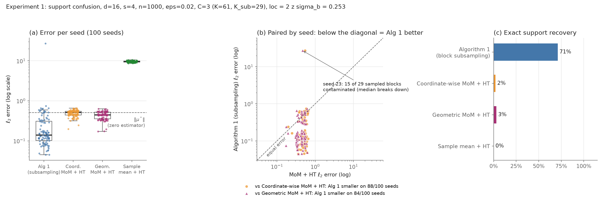
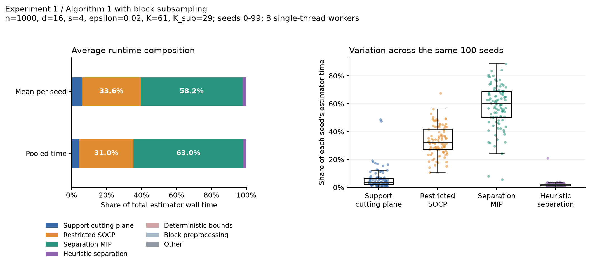
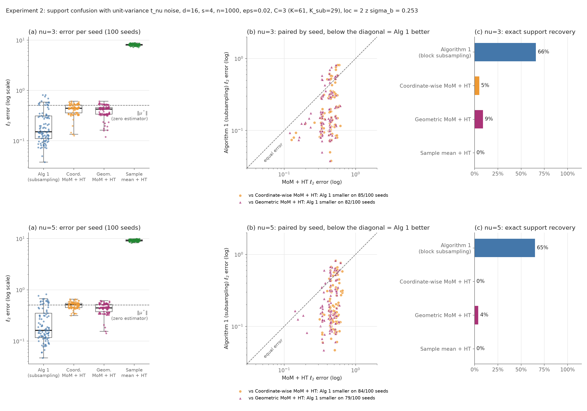
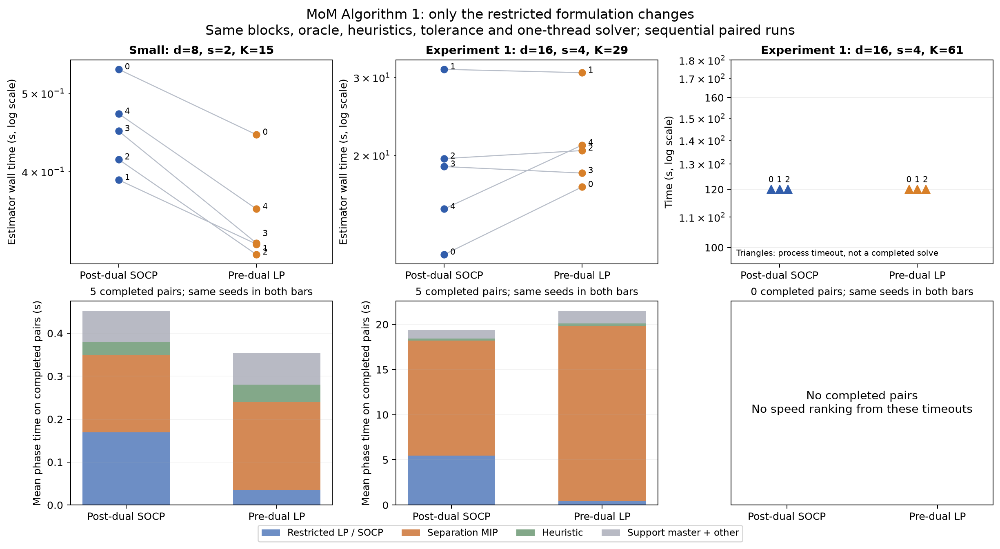

# Experiments

Results of experiments run with the refactored code (October 2026 onward). Earlier experiments are
kept locally in `previous_experiments/` and are not tracked by git.

## Experiment 1

Support confusion under a far shrink/inflate attack, $s \ll d$. Results for $(d, s, \delta, \epsilon, n) = (16, 4, 0.05, 0.02, 1000)$; $C=3$, $K=61$, block subsampling $K_{\mathrm{sub}}=29$; default tolerance $e_{\mathrm{tol}} = 10^{-3}\,U_{\det}^{(0)}$; SDP screen off. Seeds 0–99; eight one-thread workers.

Data (`results/experiment1_support_confusion/run.py`, `generate`). A random permutation of $[d]$ gives disjoint $S_{\mathrm{true}}, S_{\mathrm{adversarial}} \subset [d]$ with $|S_{\mathrm{true}}| = |S_{\mathrm{adversarial}}| = s$ ($S_{\mathrm{adversarial}}$: the coordinates the attack pushes up). Inliers:

$$X_i = \mu^* + \Sigma^{1/2} g_i, \quad g_i \overset{\mathrm{iid}}{\sim} N(0, I_d), \quad i = 1, \dots, n,$$

$$\mu^* = \mathrm{loc}\cdot\mathbf 1_{S_{\mathrm{true}}}, \qquad \Sigma = \mathrm{diag}(\sigma_1^2, \dots, \sigma_d^2), \qquad \sigma_j^2 = \begin{cases} 1, & j \in S_{\mathrm{true}} \cup S_{\mathrm{adversarial}}, \\ 0.1, & \text{otherwise}, \end{cases}$$

$$\mathrm{loc} = 2 z \sigma_b, \qquad \sigma_b = \sqrt{K/n}, \qquad z = \Phi^{-1}\Big(\frac{0.5}{1-\beta}\Big), \qquad \beta = 1 - (1 - 1/K)^{\epsilon n},$$

These are design constants computed from $(n, K, \epsilon)$ and the noise variance before any data are drawn, so $\mu^*$ is well defined. Here $\sigma_b = \sqrt{\sigma_j^2/(n/K)}$ with $\sigma_j^2 = 1$ is the population standard deviation of a clean block mean on $S_{\mathrm{true}} \cup S_{\mathrm{adversarial}}$ (blocks have $\lfloor n/K \rfloor$ or $\lceil n/K \rceil$ rows), $\beta$ is the probability that a given block of the $K$-partition contains at least one of the $\epsilon n$ outliers, and $z$ is the shift, in units of $\sigma_b$, of the median of block means when a fraction $\beta$ of the block means is pushed to one side (derived below). Choosing $\mathrm{loc} = 2z\sigma_b$ puts $S_{\mathrm{true}}$ and $S_{\mathrm{adversarial}}$ at the same height after the attack. Numerically $\beta = 0.281$, $z = 0.512$, $z\sigma_b = 0.1266$, $\mathrm{loc} = 0.2532$ and $\|\mu^*\|_2 = 0.5064$.

Contamination: with $u = (-\mathbf 1_{S_{\mathrm{true}}} + \mathbf 1_{S_{\mathrm{adversarial}}})/\sqrt{2s}$, $\hat m$ the coordinate-wise median of the data and $p_i = (X_i - \hat m)^\top u$, let $O$ index the $\epsilon n = 20$ smallest $p_i$. For $i \in O$,

$$X_i \leftarrow X_i + \big(\mathrm{med}(p) + 1000\,\mathrm{MAD}(p) - p_i\big)\, u,$$

so $p_i$ becomes $\mathrm{med}(p) + 1000\,\mathrm{MAD}(p)$ and the component orthogonal to $u$ is kept. Each coordinate in $S_{\mathrm{true}}$ moves by about $-1000\,\mathrm{MAD}(p)/\sqrt{2s} \approx -230$ and each coordinate in $S_{\mathrm{adversarial}}$ by about $+230$.

Effect on MoM: a block of the $K$-partition contains an outlier with probability about $\beta$, and its block mean is then pushed far below (on $S_{\mathrm{true}}$) or above (on $S_{\mathrm{adversarial}}$). The clean block means are about $N(\mu^*_j, \sigma_b^2)$, so the median $x_j$ of block means solves $(1-\beta)\,\Phi\big((x_j - \mu^*_j)/\sigma_b\big) + \beta = 1/2$ for $j \in S_{\mathrm{true}}$, i.e. $\Phi\big((\mu^*_j - x_j)/\sigma_b\big) = 0.5/(1-\beta)$ and $x_j = \mu^*_j - z\sigma_b$; the mirrored equation for $j \in S_{\mathrm{adversarial}}$ gives $x_j = \mu^*_j + z\sigma_b$. Hence

$$x_j \approx \mathrm{loc} - z\sigma_b = z\sigma_b \quad (j \in S_{\mathrm{true}}), \qquad x_j \approx z\sigma_b \quad (j \in S_{\mathrm{adversarial}}),$$

so $S_{\mathrm{true}}$ and $S_{\mathrm{adversarial}}$ are tied after coordinate-wise MoM. The data seed, the MoM partition seed and the block-selection seed all equal the seed. All MoM baselines keep the $s$ largest absolute coordinates (HT).

| Method | Mean L2 error | Median L2 error | Mean support recovery | Exact support | Mean runtime (s) | Completed seeds |
| --- | ---: | ---: | ---: | ---: | ---: | ---: |
| Algorithm 1 (block subsampling) | 0.486564 | 0.140398 | 0.840000 | 71/100 | 46.625721 | 100/100 |
| Coordinate-wise MoM + HT | 0.494029 | 0.516954 | 0.382500 | 2/100 | 0.000713 | 100/100 |
| Geometric MoM + HT | 0.439187 | 0.446076 | 0.495000 | 3/100 | 0.001485 | 100/100 |
| Sample mean + HT | 9.576332 | 9.562359 | 0.000000 | 0/100 | 0.000042 | 100/100 |

Per seed, Algorithm 1 (block subsampling) has a smaller L2 error than coordinate-wise MoM + HT on 88/100 seeds (median ratio 3.33), than geometric MoM + HT on 84/100 (median ratio 2.82), and than both on 83/100.

Algorithm 1 (block subsampling): on seed 23, 15 of the 29 sampled blocks contain outliers, a majority of $(29+1)/2 = 15$, so the median breaks down and the estimate is about 13.5 on four coordinates (L2 error 27.19). This single seed sets its mean; without seed 23 its mean L2 error is 0.216808, against 0.493500 for coordinate-wise MoM + HT and 0.438889 for geometric MoM + HT on the same 99 seeds. The number of contaminated sampled blocks ranged from 2 to 15 over the 100 seeds (full partition: about 17 of 61). Runtime: median 41.0 s, max 128.4 s; all runs converged. These runtimes are from the rerun after the warm-start fix in `separation_oracle` (October 15); the first run took median 27.7 s, but timing the old and new code side by side on seeds 0–3 gives the same runtimes, so the difference is machine state, not the fix. The estimates match the first run to within $1.8\times 10^{-2}$ per coordinate (62/100 seeds within $10^{-6}$), with the same exact-support count.

Per-seed records (estimates, errors, support, runtimes): [records.json](results/experiment1_support_confusion/records.json). Plot: `results/experiment1_support_confusion/plot.py`.

### Full Algorithm 1 (30-minute run, 32 seeds)

Algorithm 1 on all $K = 61$ blocks (no subsampling), same data and seeds as above, run for a fixed 30-minute wall-clock budget with eight one-thread workers; seeds were submitted in order 0, 1, … and the run was stopped at the budget. **32 seeds completed**: 0–25, 27–31 and 34; seeds still running at the budget (including 26, 32 and 33) were discarded. The other methods below are the main-run records restricted to the same 32 seeds.

| Method | Mean L2 error | Median L2 error | Mean support recovery | Exact support | Mean runtime (s) | Completed seeds |
| --- | ---: | ---: | ---: | ---: | ---: | ---: |
| Algorithm 1 (full) | 0.109967 | 0.105808 | 0.984375 | 30/32 | 395.819936 | 32/32 |
| Algorithm 1 (block subsampling) | 1.060637 | 0.152262 | 0.828125 | 21/32 | 45.861229 | 32/32 |
| Coordinate-wise MoM + HT | 0.498508 | 0.518152 | 0.375000 | 0/32 | 0.000714 | 32/32 |
| Geometric MoM + HT | 0.437665 | 0.440953 | 0.492188 | 0/32 | 0.001688 | 32/32 |
| Sample mean + HT | 9.468042 | 9.433400 | 0.000000 | 0/32 | 0.000053 | 32/32 |

Per seed, full Algorithm 1 has a smaller L2 error than block subsampling on 25/32 seeds (median ratio 1.45), and than coordinate-wise and geometric MoM + HT on all 32 (median ratios 4.83 and 4.20). On seed 23, where subsampling breaks down (15 of 29 sampled blocks contaminated), the full partition has 19 of 61 contaminated blocks, below the majority 31, and full Algorithm 1 recovers the exact support (L2 error 0.130). Without seed 23 the means are 0.109321 (full) and 0.217677 (subsampling). Full Algorithm 1 misses the exact support only on seeds 1 and 8, where subsampling also misses it. Runtime: median 359.4 s, min 91.6 s, max 972.6 s, a median of 8.0 times the subsampling runtime on the same seed; all runs converged. These seeds were run after the warm-start fix, with `IP_algorithm.py` as on disk at 12:31 on October 15.

Per-seed records: [records_full.json](results/experiment1_support_confusion/records_full.json). Runner: `results/experiment1_support_confusion/run_full.py` (usage `run_full.py BUDGET_S [WORKERS]`).

### Runtime breakdown (100 seeds)

A separate profiled run of Algorithm 1 used the same Gaussian instance, generator and seeds 0-99 as Experiment 1: $(n,d,s,\epsilon,\delta,C)=(1000,16,4,0.02,0.05,3)$, $K=61$, block subsampling $K_{\mathrm{sub}}=29$, and the default $e_{\mathrm{tol}}=10^{-3}U_{\det}^{(0)}$. Both the SDP and geometric screens were off. All 100 seeds converged within their reported optimization tolerance, and their subsampled block indices were checked against the seeded selection rule.

The timing run used up to eight one-thread workers. After an interruption, 27 completed eight-worker records were retained and the remaining 73 seeds used isolated processes with the same concurrency limit. Failed attempts and a separate two-worker trial are excluded from this analysis. The mean total estimator wall time was **81.161773 s** (median 72.743335 s). These are fresh profiling measurements; they do not replace the runtimes in the main comparison table.

| Phase | Mean time (s) | Mean per-seed share | Share of pooled time |
| --- | ---: | ---: | ---: |
| Support cutting plane | 3.557244 | 5.95% | 4.38% |
| Inner minimization (restricted SOCP) | 25.128491 | 33.61% | 30.96% |
| Separation MIP | 51.106653 | 58.20% | 62.97% |
| Other (heuristic, bounds, preprocessing and overhead) | 1.369384 | 2.24% | 1.69% |

For phase $p$ and seed $a$, let $t_{p,a}$ denote phase time and $T_a$ total estimator time. The mean per-seed share is $\frac{1}{100}\sum_{a=0}^{99}t_{p,a}/T_a$, giving every seed equal weight; the pooled share is $\sum_a t_{p,a}/\sum_a T_a$, giving longer runs more weight. Seed 23 is included in both summaries.

Phase times include model construction, optimization, solution/dual extraction and disposal. The support cutting-plane time excludes the entire inner support callback, so it does not double-count restricted SOCP or separation time. The "Other" row includes heuristic separation (including its small fixed-pair convex solves), deterministic bounds, block preprocessing and remaining overhead. Imports, data generation and result serialization are outside estimator timing. The phase times sum to the total time for every seed and agree with the estimator's built-in restricted/oracle timers.

Within the restricted SOCP phase, calls to `optimize` averaged **8.844536 s**, or 35.2% of that phase; the remaining 64.8% covers model construction, extraction, disposal and other overhead. Within the separation MIP phase, `optimize` averaged **49.669590 s**, or 97.2%. Separation MIP optimization is the largest cost; support cutting planes take a much smaller share.

Profiling artifacts: [summary.json](results/experiment1_support_confusion/runtime_profile_100seeds/summary.json), [per-seed times (CSV)](results/experiment1_support_confusion/runtime_profile_100seeds/per_seed_times.csv), [full records](results/experiment1_support_confusion/runtime_profile_100seeds/records.json), and [metadata and source hashes](results/experiment1_support_confusion/runtime_profile_100seeds/metadata.json). Runners: `results/experiment1_support_confusion/runtime_profile_100seeds/profile_seeds.py` and `analyze.py`; frozen inputs and source files are in its `source/` directory. Like the other experiment artifacts, these files remain local under the git-ignored `results/` directory.

## Experiment 2

Support confusion as in Experiment 1, with heavy-tailed noise. Results for $(d, s, \delta, \epsilon, n) = (16, 4, 0.05, 0.02, 1000)$ and $\nu \in \{3, 5\}$; $C=3$, $K=61$, block subsampling $K_{\mathrm{sub}}=29$; default tolerance $e_{\mathrm{tol}} = 10^{-3}\,U_{\det}^{(0)}$; SDP screen off. Seeds 0–99; $\nu = 3$ and $\nu = 5$ ran at the same time with five one-thread workers each.

Data (`results/experiment2_t_noise/run.py`, `generate`; usage `run.py NU [WORKERS]`). $S_{\mathrm{true}}$, $S_{\mathrm{adversarial}}$, $\mu^*$, $\Sigma$, $\mathrm{loc}$ and the contamination are as in Experiment 1; only the law of $g_i$ changes:

$$X_i = \mu^* + \Sigma^{1/2} g_i, \qquad g_{ij} \overset{\mathrm{iid}}{\sim} \sqrt{\frac{\nu-2}{\nu}}\; t_\nu, \quad j = 1, \dots, d,$$

so $\mathbb E g_{ij} = 0$ and $\mathrm{Var}(g_{ij}) = 1$. The design constants $\sigma_b$, $\beta$, $z$ and $\mathrm{loc}$ depend on the noise only through its variance, so they are unchanged ($\mathrm{loc} = 0.2532$). The calibration $x_j \approx z\sigma_b$ for both $S_{\mathrm{true}}$ and $S_{\mathrm{adversarial}}$ uses the normal approximation of a clean block mean of about $n/K \approx 16$ rows, which still holds near the center for $\nu \in \{3, 5\}$. The data seed, the MoM partition seed and the block-selection seed all equal the seed. All MoM baselines keep the $s$ largest absolute coordinates (HT).

$\nu = 3$:

| Method | Mean L2 error | Median L2 error | Mean support recovery | Exact support | Mean runtime (s) | Completed seeds |
| --- | ---: | ---: | ---: | ---: | ---: | ---: |
| Algorithm 1 (block subsampling) | 0.238676 | 0.151873 | 0.820000 | 66/100 | 71.197510 | 100/100 |
| Coordinate-wise MoM + HT | 0.433760 | 0.445740 | 0.510000 | 5/100 | 0.000720 | 100/100 |
| Geometric MoM + HT | 0.401860 | 0.429127 | 0.577500 | 9/100 | 0.001584 | 100/100 |
| Sample mean + HT | 8.109423 | 8.120835 | 0.000000 | 0/100 | 0.000044 | 100/100 |

$\nu = 5$:

| Method | Mean L2 error | Median L2 error | Mean support recovery | Exact support | Mean runtime (s) | Completed seeds |
| --- | ---: | ---: | ---: | ---: | ---: | ---: |
| Algorithm 1 (block subsampling) | 0.257154 | 0.163086 | 0.802500 | 65/100 | 69.886178 | 100/100 |
| Coordinate-wise MoM + HT | 0.500418 | 0.513519 | 0.360000 | 0/100 | 0.000766 | 100/100 |
| Geometric MoM + HT | 0.443987 | 0.447244 | 0.480000 | 4/100 | 0.001632 | 100/100 |
| Sample mean + HT | 9.211436 | 9.201297 | 0.000000 | 0/100 | 0.000038 | 100/100 |

Per seed, Algorithm 1 (block subsampling) has a smaller L2 error than coordinate-wise MoM + HT on 85/100 seeds for $\nu = 3$ (median ratio 2.44) and 84/100 for $\nu = 5$ (median ratio 2.73), than geometric MoM + HT on 82/100 (2.15) and 79/100 (2.34), and than both on 82/100 and 79/100.

Algorithm 1 (block subsampling): no seed breaks down; the largest L2 error is 0.82 for both $\nu$. The number of contaminated sampled blocks ranged from 3 to 13 ($\nu = 3$) and from 4 to 13 ($\nu = 5$), always below the majority 15 of the 29 sampled blocks (full partition: about 17 of 61). Its mean L2 error is therefore below the Gaussian mean 0.4866 of Experiment 1, which seed 23 alone inflates, and close to the Gaussian mean without seed 23 (0.2168). The support confusion persists for the MoM baselines (0–9 exact supports out of 100). Runtime: median 64.3 s ($\nu = 3$) and 61.8 s ($\nu = 5$), max 212 s; all runs converged. The machine was under extra load during these runs, so runtimes are not comparable with Experiment 1.

Before the warm-start fix in `separation_oracle`, seed 51 ($\nu = 3$) and seed 87 ($\nu = 5$) failed with a spurious Gurobi error, "Q matrix is not positive semi-definite": the oracle passed a warm start that its own threshold screening had removed, and Gurobi 13.0.3 fails while repairing such a start. All 100 seeds above were run after the fix.

Per-seed records (estimates, errors, support, runtimes): [records_nu3.json](results/experiment2_t_noise/records_nu3.json), [records_nu5.json](results/experiment2_t_noise/records_nu5.json). Plot: `results/experiment2_t_noise/plot.py`.

## MoM Algorithm 1: before versus after dualization (October 15, 2026)

The LP formulation was not adopted; its code, tests and runner moved to `previous_experiments/oracle_speedups_2026_10/directional_lp/` on October 21, 2026.

This paired benchmark compares the pre-dualization directional LP (`formulation="lp"`) with the existing post-dualization `(S,B)` SOCP (`formulation="socp"`). Both use the same support MILP, initializer, coordinate box, heuristic separation, exact separation MIP, row/pair screening, warm starts, support deferral/pruning, and gap tests. The optional SDP and geometric screens are off. Both restricted models are rebuilt at every solve.

Each pair receives byte-identical saved block arrays and the same absolute tolerance `1e-3 * U0`; the inner and separation tolerances are `tol/4` and `tol/8`. Fits run sequentially in fresh processes with one Gurobi/BLAS thread, alternating method order by seed. The reported estimator time includes model construction and optimization on precomputed blocks; data generation, imports and initial license warmup are excluded. The small case uses seeds 0–4. The existing Experiment 1 subsampled case uses seeds 0–4, whose inputs were independently checked for exact agreement with the original generator and block-selection rule. Full-block cases use seeds 0–2. Process cutoffs are 180 s for the first two cases and 120 s for full blocks, including process startup.

| Case | Completed pairs | LP median (s), paired | SOCP median (s), paired | Median paired SOCP / LP | LP faster pairs | LP / SOCP timeouts |
| --- | ---: | ---: | ---: | ---: | ---: | ---: |
| Small (n=400, d=8, s=2, K=15) | 5/5 | 0.326 | 0.449 | 1.311 | 5/5 | 0 / 0 |
| Experiment 1 subsampled (n=1000, d=16, s=4, K=29) | 5/5 | 20.489 | 18.851 | 0.959 | 2/5 | 0 / 0 |
| Experiment 1 full (n=1000, d=16, s=4, K=61) | 0/3 | — | — | — | — | 3 / 3 |

A ratio above one means LP is faster. The paired ratio is computed per seed before taking its median; it is not the ratio of the two runtime medians. Timeouts are retained and are not assigned a completed-solve runtime or included in a completed-only speed ranking.

The small cases favor LP, while the existing subsampled workload shows no consistent large advantage: LP wins two seeds and SOCP wins three. The median paired comparison is about 4.1% less time for SOCP. Five seeds with one timing per method/seed are an initial measurement, not a statistically established general ranking.

For the existing subsampled workload, the mechanism is visible in the mean phase times:

| Phase or count | LP | SOCP |
| --- | ---: | ---: |
| Restricted minimization (s) | 0.472 | 5.470 |
| Separation MIP (s) | 19.323 | 12.722 |
| Heuristic (s) | 0.307 | 0.234 |
| Support master and other (s) | 1.395 | 0.940 |
| Separation calls | 79.200 | 41.000 |
| Restricted solves | 304.800 | 144.000 |

The cheaper restricted LP is offset by more generated directions, restricted iterations, and expensive separation calls. LP `constraints` counts directions (two linear inequalities each); SOCP `constraints` counts `(S,B)` convex-hull distance constraints, so those counts are different units.

All completed paired runs use the same input hashes and tolerance. Their final certified optimality intervals overlap, and each successful run has `gap <= tol`. Agreement is in the objective and certificates; estimates need not coincide when the objective is flat or nearly flat. New tests compare the LP against independent HiGHS LP solutions and tiny exhaustive/analytic MoM references, check global support-cut validity including zero/fractional supports, verify returned oracle directions and certificate-only results, and ensure distinct directions sharing `(S,B)` are not incorrectly deduplicated. The complete regression suite passed: **141 tests**, including six new tests.

Code was based on commit `358a62978719deb42ec77df09ac4b9a108783a9a`. Source hashes, environment information, raw per-run results and exact block arrays are retained with the experiment. Full-block timeout results alone do not establish which formulation is faster.

Artifacts: [summary](results/mom_dualization_comparison/report/summary.json), [per-run CSV](results/mom_dualization_comparison/report/runs.csv), [full records and metadata](results/mom_dualization_comparison/report/records.json). Inputs and original run records are under `results/mom_dualization_comparison/subsampled/` and `full/`; a frozen implementation is in `source/`. The reproducible runner is [`compare_mom_formulations.py`](previous_experiments/oracle_speedups_2026_10/directional_lp/compare_mom_formulations.py).

## MoM Algorithm 1: optional sorting–IHT (October 15, 2026)

Sorting–IHT was not adopted; its code, tests and runner moved to `previous_experiments/oracle_speedups_2026_10/sorting_iht/` on October 21, 2026.

The primary proposed heuristic is implemented as an opt-in accelerator: an instance-owned direction cache, threshold squared-hinge sorting–IHT with exact sparse-ball projection and fixed-B backtracking, bounded support swaps, then the existing fixed-pair polishing and exact separator. Each emitted cut is checked using actual sparse residual projections. `UNKNOWN` is never used as an upper bound or an optimality certificate. Dense relaxation seed generation and raw median-gradient ascent are not part of this implementation.

Algorithm 1 accepts `iht_time_limit=0.02` for either restricted formulation; the default remains `0` (off). The time budget is soft and applies per search. Both formulations retain identical cut thresholds and certified gap tolerances. The internal descent uses ball projection, while emitted/cache directions are unit-normalized to strengthen LP cuts. Initial seeds are compared before descent. After eight consecutive IHT cuts, the shared policy runs one legacy-search pass: otherwise threshold-feasibility cuts can cause a long sequence of tiny improvements in the directional LP.

Fresh on/off timings use seeds 0–2, identical saved block arrays and absolute `tol = 1e-3 * U0`, sequential fresh processes, one Gurobi/BLAS thread, alternating method order, and disabled SDP/geometric screens. Successful timings include estimator/model work on the supplied blocks but exclude data generation, imports, and initial license warmup. Every process has a 120-second cutoff. All 24 fits completed and converged.

| Case | Formulation | Off median (s) | On median (s) | Median paired off / on | IHT faster pairs |
| --- | --- | ---: | ---: | ---: | ---: |
| Small (n=400, d=8, s=2, K=15) | SOCP | 0.441 | 0.599 | 0.828 | 0/3 |
| Small (n=400, d=8, s=2, K=15) | LP | 0.338 | 0.462 | 0.775 | 0/3 |
| Experiment 1 subsampled (n=1000, d=16, s=4, K=29) | SOCP | 19.765 | 22.099 | 0.943 | 1/3 |
| Experiment 1 subsampled (n=1000, d=16, s=4, K=29) | LP | 21.145 | 31.979 | 0.952 | 0/3 |

A paired ratio above one means IHT is faster. Ratios are computed within each seed before taking the median, rather than dividing the runtime medians. These three-seed measurements show no consistent speed improvement at the tested budget. Small fits are slower with IHT in every pair. On the 29-block workload, SOCP is faster in one of three pairs and LP in none. SOCP mean total time does decrease slightly (20.813 to 19.805 seconds), driven by the faster seed, despite its unfavorable median paired ratio. No general speed ranking is established by three single timings.

Mean phase times and counts on the 29-block workload:

| Metric | SOCP off | SOCP on | LP off | LP on |
| --- | ---: | ---: | ---: | ---: |
| Restricted minimization (s) | 4.922 | 5.559 | 0.443 | 0.887 |
| Exact separation (s) | 14.601 | 12.411 | 21.272 | 24.962 |
| All heuristic work (s) | 0.233 | 1.083 | 0.309 | 1.909 |
| IHT time, included above (s) | 0.000 | 0.909 | 0.000 | 1.636 |
| Exact separator calls | 38.000 | 32.333 | 77.667 | 82.333 |
| Exact certificates | 1.333 | 1.333 | 2.000 | 2.000 |
| IHT cuts | 0.000 | 39.333 | 0.000 | 260.333 |
| Cache cuts, included above | 0.000 | 2.667 | 0.000 | 10.667 |
| Forced legacy refreshes | 0.000 | 0.667 | 0.000 | 24.333 |

The heuristic finds valid cuts, but additional direction cuts can change the support path and increase subsequent exact work. For example, LP seed 0 discovers 391 IHT cuts yet uses 108 exact calls instead of 71, increasing total runtime from 17.690 to 33.647 seconds. Thus IHT cut counts alone are not a speed measure. In these runs the extra heuristic work and changed cutting-plane paths offset most or all of the intended savings.

Every on/off pair has matching input hashes and tolerances and overlapping final certified objective intervals; all final gaps are at most `tol`. The largest objective difference is below 0.20 tolerances. Source, runner, and generator hashes were unchanged throughout measurement. The complete regression suite passed **162 tests**, including 21 new tests for projection, descent, support changes, cache isolation/signs, extreme-outlier numerical guards, stronger emitted witnesses, duplicate-pair handling, periodic polishing, UNKNOWN fallback, and exhaustive LP/SOCP on/off certificates.

Reproduce with `python previous_experiments/oracle_speedups_2026_10/sorting_iht/compare_sorting_iht.py --seeds 3 --budget 0.02 --formulations socp,lp --timeout 120`. The runner also supports `--cases experiment1_full`, but the new heuristic was not timed on that 61-block case here.

Artifacts: [paired summary](results/sorting_iht_comparison/summary.json), [per-run CSV](results/sorting_iht_comparison/runs.csv), [full records and metadata](results/sorting_iht_comparison/records.json), [verification](results/sorting_iht_comparison/verification.json), and [test log](results/sorting_iht_comparison/tests.txt). Exact inputs, frozen implementation, and the previous implementation snapshot are retained in the same ignored results directory. The reusable runner is [`compare_sorting_iht.py`](previous_experiments/oracle_speedups_2026_10/sorting_iht/compare_sorting_iht.py).

## MoM Algorithm 1: active-pair swap search (October 16, 2026)

### Why exact separation was needed

Instrumented runs on the Experiment 1 instance (`generate` in `previous_experiments/oracle_speedups_2026_10/directional_lp/compare_mom_formulations.py`, the Experiment 1 generator; default tolerance; subsampled K=29 seeds 0–5 and full K=61 seeds 0–2) logged every exact-oracle call and, at each call, also solved the separation MIP to optimality for the true F(mu). Counts are for K=29 unless stated.

- Exact calls happen only while certifying the final one to three revisited supports; first visits never call the oracle. 229 of 238 calls returned a cut and 9 a certificate, and certificates took 6–15% of exact-oracle time at both K (K=61: 32 of 33, 69 of 70 and 68 of 70 calls were cuts).
- The legacy heuristic found a cut in 284 of 599 first-visit calls but 8 of 246 revisit calls. At the exact cut calls F(mu) − L had seed medians of 17–41 tol (maximum 182), while the heuristic's best witness had seed medians between 0 and −127 tol relative to L. In 59% of revisit calls its best pair was already in the restricted problem.
- First-visit heuristic cuts follow the signal: ⟨mu* − mu, v⟩ is a median 51–86% of the violation (seeds 0, 3, 5). Exact cuts on the final support are noise extremes (2–7%) that keep every contaminated block above the median. When the certification loops started, the legacy candidates (coordinate median, mean, large rows) were 78–163 tol below L.
- The restricted problem has about five pairs within tol/4 of L, and 85% of the exact cuts are within one support-coordinate swap, with the blocks reselected, of a pair it already contains. Searching those swaps found a violated pair at 223 of 229 logged cut states (K=61, seeds 0–1: 100 of 101).
- Exact cuts are the first incumbent above the threshold: median depth 3–10 tol, and 3–16% are the most violated pair. Returning the most violated pair instead cut exact calls from 238 to 90 but made the runs slower overall (full solves without screening). Loosening rtol from 1e-3 to 1e-2 cut them only to 188 and changed the support selected for seed 4.

### Swap search

`ConstraintGeneration` now runs `swap_separation` after a failed heuristic on supports being certified (README, Algorithm 1). Code before and after the change ran on identical generated instances and tolerances, with eight one-thread workers running both versions concurrently; imports and license warm-up are excluded.

| Case | Before (s) | After (s) | Paired speedup, median (range) | Exact calls |
| --- | ---: | ---: | ---: | ---: |
| Subsampled, K=29, seeds 0–5 | 210.8 | 136.3 | 1.61 (1.21–1.75) | 238 → 57 |
| Full, K=61, seeds 1–2 | 767.6 | 377.1 | 2.09 (1.88–2.30) | 140 → 37 |

All 16 runs converged; certified objectives agree within 0.19 tol and L2 errors within 5e-5. The swap search took 4.9 s (K=29, six seeds) and 4.4 s (K=61, two seeds) in total. The exact calls it leaves are the costly ones, certificates and violations outside the swap neighbourhood: 0.84 s per call at K=29 (0.57 s before) and 8.6 s at K=61 (5.2 s before). Restricted SOCP time rose from 63.6 to 72.0 s (K=29) and from 40.0 to 50.8 s (K=61), because certification loops add more, shallower pairs.

### Proximal stabilization (measured, not adopted)

A bundle-type certification loop separated at the proximal point argmin F_P(mu) + ||mu − center||²/(2t) instead of the restricted minimizer. The center moved there whenever the heuristic and the swap search found nothing, and the exact oracle ran once F_P at the center was within tol/8 of L. t started at 32 or 128 tol, doubled after each such step and halved (not below its start) after each cut. L and the support cuts still came from the unregularized restricted SOCP. Same instances, rerun against the new code (paired speedup medians in parentheses):

| Case | Plain (s) | t₀ = 32 tol (s) | t₀ = 128 tol (s) | Certification-loop cuts, plain / 32 / 128 | Exact calls, plain / 32 / 128 |
| --- | ---: | ---: | ---: | ---: | ---: |
| Subsampled, K=29, seeds 0–5 | 142.0 | 177.9 (0.81) | 158.0 (0.83) | 249 / 267 / 255 | 57 / 70 / 54 |
| Full, K=61, seeds 1–2 | 418.9 | 503.9 (0.81) | 479.0 (0.87) | 144 / 153 / 147 | 37 / 43 / 35 |

All runs converged with objectives within 0.24 tol of the plain loop. Stabilization needs fewer unregularized restricted solves but adds proximal solves, and it does not reduce the number of pairs a certification loop adds. That number follows the depth of the cuts, as the most-violated-pair run above shows, not the point where they are separated.

The full test suite passes (164 tests, including new tests for the NNLS fixed-pair direction and the swap search).

Artifacts (local, git-ignored) in `results/swap_search_comparison/`: `benchmark/` (runner `bench_worker.py`, `run_bench1.sh`, `run_bench2.sh`, `table_b.py`, the stabilization prototype `stabilized.py`, and per-run records), `diagnosis/` (instrumented runs, analysis scripts, and `certification_loop_seed0.png`), and the frozen code in `source_before/` and `source_after/`.

## MoM Algorithm 1: corral drops in the swap search (October 20, 2026)

### Why

Every exact-oracle call of the current code was logged on the Experiment 1 instance (full K=61, seeds 0–3: 63 calls; subsampled K=29, seeds 0–2: 29 calls). The number of exact calls hardly changes with K (12–24 at K=61, 4–14 at K=29), but one call does: a cut call takes 3.5–14 s at K=61 against 0.2–0.8 s at K=29 (seed medians), a certificate 9–33 s against 0.7–2.2 s. At K=61, 75–86% of the exact time goes to cut calls, not certificates.

At these cut states the support-swap neighbourhood is exhausted: run without a deadline, the swap search finds no violated pair at any of the 57 K=61 states. Dropping one block of an active pair's min-norm corral (the blocks with positive NNLS weight), optionally after one support swap, and then alternating the fixed-pair direction with its top-h blocks finds one at 52 of the 57 states, in a median 0.18 s (the exact MIP took 2–34 s). Only corral blocks matter: dropping a block with zero weight leaves the min-norm point, and hence the fixed-pair value, unchanged.

`swap_separation` now runs these drops as a second pass when its support swaps find nothing, under the same deadline and hit limit; `_pair_direction` also returns the NNLS weights.

### Benchmark

Code before and after the change (frozen copies) ran on identical generated instances and tolerances, four one-thread workers with the two versions of a seed next to each other in the queue (Apple M4); imports and license warm-up are excluded.

| Case | Before (s) | After (s) | Paired speedup, median (range) | Exact calls |
| --- | ---: | ---: | ---: | ---: |
| Full, K=61, seeds 0–3 | 772.4 | 477.3 | 1.67 (1.11–2.15) | 63 → 27 |
| Subsampled, K=29, seeds 0–5 | 141.3 | 139.6 | 0.93 (0.89–1.54) | 57 → 32 |

All 20 runs converged with the same selected supports; certified objectives agree within 0.12 tol and L2 errors within 6e-5. Certificates are unchanged (6 and 9 calls); the swap search took 24.0 s instead of 8.9 s at K=61. At K=29 an avoided exact call saved about 0.8 s of MIP time, and the extra searches and restricted solves cost about as much (exact oracle −19 s, swap search +10 s, restricted SOCP +7 s over the six seeds), so the runs did not get shorter; at K=61 an avoided call saved 8.6 s for about 0.4 s. The exact cuts that remain are 1–3 support swaps and 3–13 block swaps away from the active pairs and out of reach of cheap neighbourhoods (two drops, drop then swap).

The same comparison on the Experiment 2 data (Student-t noise, `results/experiment2_t_noise/run.py`'s generator, `ip_estimation` called as in that experiment), same setup:

| Case | Before (s) | After (s) | Paired speedup, median (range) | Exact calls |
| --- | ---: | ---: | ---: | ---: |
| ν = 3, full, K=61, seeds 0–3 | 756.4 | 503.6 | 1.43 (0.96–2.01) | 73 → 35 |
| ν = 3, subsampled, K=29, seeds 0–5 | 79.5 | 76.3 | 1.05 (0.96–1.08) | 39 → 23 |
| ν = 5, full, K=61, seeds 0–3 | 545.9 | 364.2 | 1.40 (1.20–1.62) | 54 → 26 |
| ν = 5, subsampled, K=29, seeds 0–5 | 109.5 | 97.6 | 1.10 (0.85–1.32) | 83 → 37 |

All 40 runs converged with the same selected supports; certified objectives agree within 0.17 tol and L2 errors within 3e-4, and certificate counts are unchanged.

### Measured, not adopted

Suggestions from an external review of the oracle, measured on the same instances. Per-call numbers replay the 63 logged K=61 exact calls with the same threshold and warm start (time relative to the current MIP, cut calls / certificates); end-to-end numbers are paired speedups at K=61.

| Change | Result |
| --- | --- |
| Ranking constraints: unselected blocks below the level (`r_k @ v <= level + R_k b_k`) | 1.01× / 1.20× the time (nodes 0.81×) |
| Same with `level >= T` and big-M `max(R_k - T, 0)` | 2.3× / 2.5×, 11 time-outs |
| Threshold count form (level fixed at T, `sum(b) >= h`), without / with ranking | 1.01× / 0.97×; 1.07× / 1.09× |
| Gurobi `Cutoff = T`; level capped at T + 2·margin | 1.11× / 1.46×; certificates 2.7× |
| Support-aware conflict cuts from the restricted pairs' corrals, capped / lifted coefficients | certificates 1.9× / 1.6×, 0 of 6 faster |
| Root quantile and star (mixing) cuts along the relaxation direction | 1.07× / 1.26×; on the count form 0.88× / 0.80× (3 of 6 certificates faster) |
| Branching priority on the support binaries | 4.5×, all certificates time out |
| `MIQCPMethod=1` | 0.90× / 1.18×; end to end 0.97× alone, 1.74× with the corral drop (seed 1 slower in two batches) |
| Pair-graph screen (core peeling, colouring, pairwise quantile bound) | certifies 0 of 92 calls: a compatible h-clique always exists |
| Swap search returning its three deepest pairs; exact direction as warm start | end to end 0.91×; 0.78× |
| Exact MIP branching 1 s past the first cut, adding its pool pairs | exact calls 63 → 56, no oracle-time gain |
| Local branching (two support swaps, free blocks) for half the mean exact-call time before the MIP | 6 of 30 calls resolved; with the corral drop 1.22× against 1.33× without |
| Pair-screening budget, completing supports below q, Lipschitz cache of certificates | 0.06–0.16% of exact time; 3 of 857 pairs; 0 of 92 calls |

Restrictions valid only for solutions with level ≥ T (the conflict, mixing and count cuts, `level >= T`, `Cutoff`) make the MIP bound no longer an upper bound of F(mu); a certificate from such a model must report U = T, not the bound.

The full test suite passes (170 tests, including a new test in which only a corral drop finds the violated pair).

Artifacts (local, git-ignored) in `results/corral_drop_comparison/`: `benchmark/` (runner, worker and per-run records), the frozen code in `source_before/` and `source_after/`, and `evaluation/` (call logging, per-call replays of the variants above, and their summaries).
